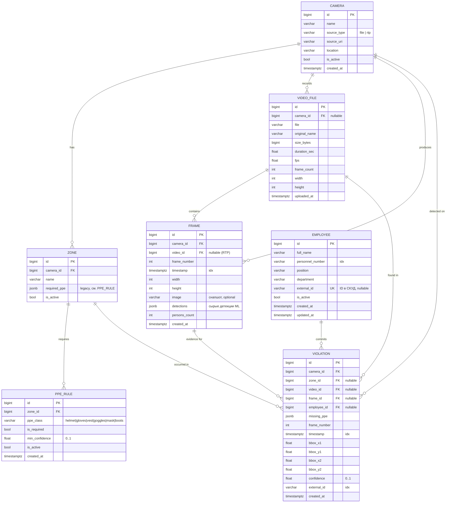

# ER-диаграмма БД (PPE Monitor)

Приложение Django `monitoring`, СУБД PostgreSQL 16.



## Индексы и ограничения

| Таблица | Индекс / ограничение | Зачем |
|---|---|---|
| `monitoring_violation` | `timestamp`, `(camera_id, timestamp DESC)`, `(zone_id, timestamp DESC)`, `(employee_id, timestamp DESC)` | фильтры журнала нарушений по времени, камере, зоне, сотруднику |
| `monitoring_violation` | `CHECK 0 <= confidence <= 1` | валидность score от ML |
| `monitoring_frame` | `timestamp`, `(camera_id, timestamp DESC)` | выборка кадров по камере и времени |
| `monitoring_frame` | `UNIQUE (video_id, frame_number)` при `video_id`/`frame_number` NOT NULL | нет дублей кадров одного видео; для RTP (`video_id IS NULL`) не действует |
| `monitoring_ppe_rule` | `UNIQUE (zone_id, ppe_class)`, `CHECK 0 <= min_confidence <= 1` | одно правило на класс СИЗ в зоне |
| `monitoring_employee` | `UNIQUE external_id` (NULL допускается многократно), индекс `personnel_number` | сопоставление с СКУД |

## Интеграция со СКУД

`Employee.external_id` — идентификатор сотрудника во внешней СКУД (номер пропуска/карты).
Поле nullable и уникальное: сотрудники заводятся до интеграции без него, а при синхронизации
сопоставляются по `external_id`. `Violation.employee` заполняется, когда нарушителя удаётся
идентифицировать (СКУД / распознавание), иначе остаётся `NULL`.

## Миграции

| Файл | Что делает |
|---|---|
| `0001_initial` | Camera, Zone, VideoFile, Violation (ветка backend) |
| `0002_employees_ppe_rules_frames` | Employee, PPE_Rules, Frames; `Violation.frame`, `Violation.employee`; индексы и ограничения |
| `0003_fill_ppe_rules_from_zones` | data-миграция: переносит `Zone.required_ppe` в PPE_Rules |

```bash
cd backend
python manage.py migrate                 # применить
python manage.py migrate monitoring 0001 # откатить изменения этой ветки
```
